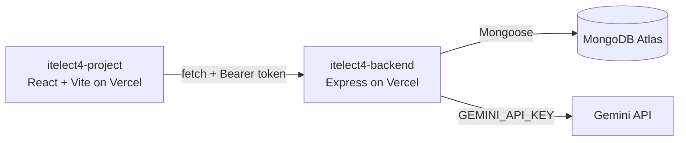

# itelect4-backend

REST API for the Campus Lost & Found Tracker: Express 5 in TypeScript,
MongoDB Atlas through Mongoose, JWT login, and one route that asks Gemini
to check a student's description of a lost item.

- **Live API:** https://itelect4-backend-beta.vercel.app/api/health
- **Frontend repo:** https://github.com/OwenLR/itelect4-project

## What it does

Students register and log in, browse found and lost items (public), and
create and manage their own claims on items (private). `POST /api/ai`
returns a checked review of an item description.

## Architecture

## Run it locally

1. `npm install`
2. `copy .env.example .env`, then fill in `MONGODB_URI`, `JWT_SECRET`,
   `CORS_ORIGIN` (`http://localhost:5173`) and `GEMINI_API_KEY`.
3. `npm run seed` once, then `npm run dev` (http://localhost:4000).
4. `npm test` runs the Supertest tests.

## AI-use disclosure

Used Claude (Anthropic), via the claude.ai chat interface, as a coding
assistant. No other AI tool is used.

Where Claude assisted
- Adapting the class-demo patterns to this Lost and Found app (User / Item / Claim) and
  flagging where a pattern did not fit.
- Troubleshooting setup and deployment errors (tsconfig, PowerShell,
  Vercel, CORS, Atlas).
